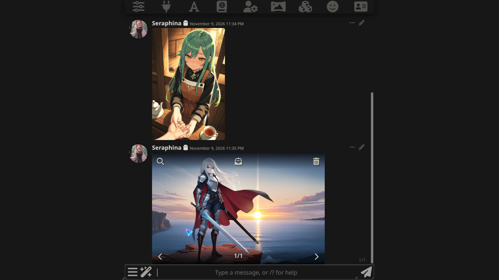
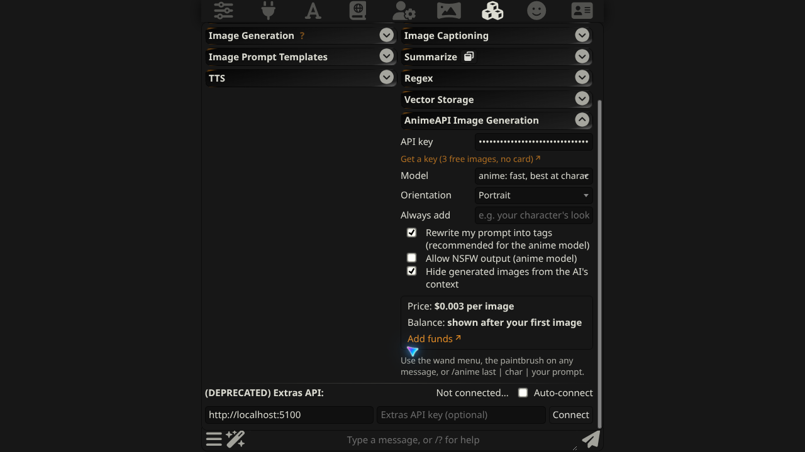

# AnimeAPI 画像生成（SillyTavern 拡張機能）

[AnimeAPI](https://animeapi.ai) で SillyTavern のチャットからアニメイラストを生成します。AnimeAPI は最安クラスのアニメ画像 API です：**1 枚 $0.003**、プリペイド残高は $5 から・無期限、サブスクリプションなし。新規アカウントは無料 3 枚、カード不要。

[English](README.md) · [简体中文](README.zh-CN.md) · **日本語**



## 機能

- **最後のメッセージ**、**キャラクター**、または**自由なプロンプト**をイラスト化
- `/anime` スラッシュコマンド、杖メニューの 3 項目、各メッセージのボタン
- モデル（`anime` $0.003、`ultra` $0.01、`ultra-max` $0.02）と向き（縦長・正方形・横長）を選択
- **1 枚あたりの価格**と**残高**を表示
- 画像はダウンロードして SillyTavern の画像フォルダに保存し、チャットに追加
- わかりやすいエラー：残高不足ならチャージページへのリンク、拒否された場合は理由を表示
- サーバープラグイン不要、ローカル GPU 不要。UI は English・简体中文・日本語

## インストール

1. SillyTavern で **拡張機能**（キューブのアイコン）→ **拡張機能をインストール** を開きます。
2. 次の URL を貼り付けて確定します：

   ```
   https://github.com/animeapi-ai/SillyTavern-AnimeAPI
   ```

3. **拡張機能 → AnimeAPI 画像生成** を開き、API キーを貼り付けます。キーは <https://animeapi.ai/dashboard/api-keys> で作成できます（`ank_` で始まります）。

SillyTavern 1.12.6 以降が必要です。1.19.0 で動作確認済み。



## 使い方

| 場所 | 動作 |
| --- | --- |
| 杖メニュー → **AnimeAPI：最後のメッセージ** | 最後のメッセージの場面を描く |
| 杖メニュー → **AnimeAPI：キャラクター** | キャラクター説明から現在のキャラを描く |
| 杖メニュー → **AnimeAPI：自由入力** | 描きたい内容を入力 |
| メッセージの **⋯** メニュー → キラキラボタン | そのメッセージを描く |
| `/anime last`、`/anime char`、`/anime 赤い傘の少女` | 同じ操作のスラッシュコマンド |

スラッシュコマンドはオプション引数を受け取り、保存した画像のパスを返します。クイックリプライやスクリプトで使えます：

```
/anime model=ultra orientation=landscape a cafe chalkboard that reads OPEN LATE
/anime quiet=true char | /echo saved to {{pipe}}
```

## 設定

| 設定 | 既定 | 説明 |
| --- | --- | --- |
| API キー | 空 | あなたの SillyTavern の設定に保存され、`animeapi.ai` にのみ送信されます |
| モデル | `anime` | 1 枚 `anime` $0.003、`ultra` $0.01、`ultra-max` $0.02 |
| 向き | 縦長 | 縦長・正方形・横長、価格は同じ |
| 常に追加 | 空 | すべてのプロンプトに追加する文字列（例：キャラの外見） |
| タグに自動変換 | オン | AnimeAPI が文章を anime モデル用のタグに書き換えます |
| NSFW 出力を許可 | オン | AnimeAPI 自体の既定値です。オフにすると、該当画像は拒否され返金されます。anime モデルのみ |
| 生成画像を AI のコンテキストに含めない | オン | 画像メッセージはチャットモデルに送信されません |

チャット本文は Markdown を除去し、AnimeAPI の上限 1,000 文字に切り詰めます。

## 表示されるエラー

| メッセージ | 意味 |
| --- | --- |
| AnimeAPI の残高がありません | <https://animeapi.ai/dashboard/billing> でチャージ（$5 から） |
| AnimeAPI がこのキーを受け付けませんでした | <https://animeapi.ai/dashboard/api-keys> でキーを確認 |
| 画像が拒否されました：… | モデルがこのプロンプトを拒否しました。理由が表示され、課金されません |
| AnimeAPI が混雑しています | 一時的なものです。数秒後に再試行してください。失敗した画像は返金されます |

## SillyTavern 標準の画像生成は使えますか？

現時点では使えません。標準の Image Generation 拡張機能（1.19.0）には、任意の OpenAI 互換ベース URL を指定できるソースがなく、「OpenAI」ソースは常に OpenAI のサーバーを呼び出します。本拡張機能をご利用ください。

## リンク

- AnimeAPI：<https://animeapi.ai> · [ドキュメント](https://animeapi.ai/docs) · [API リファレンス](https://animeapi.ai/docs/api-reference)
- ライセンス：[MIT](LICENSE)
