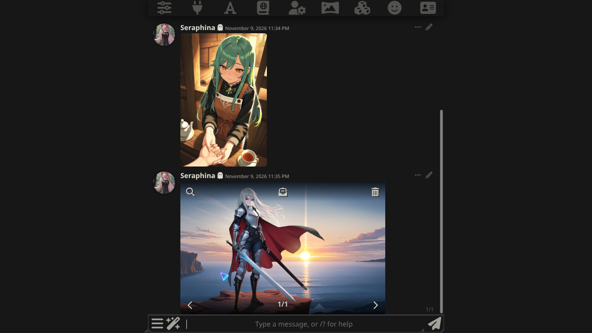
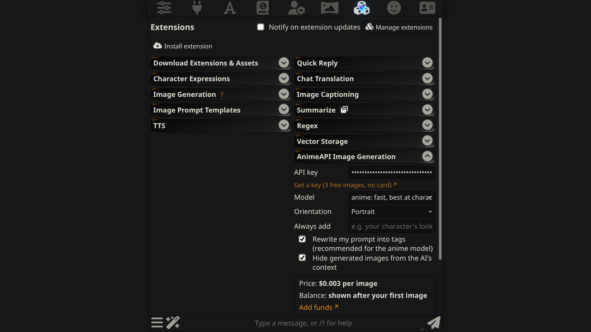
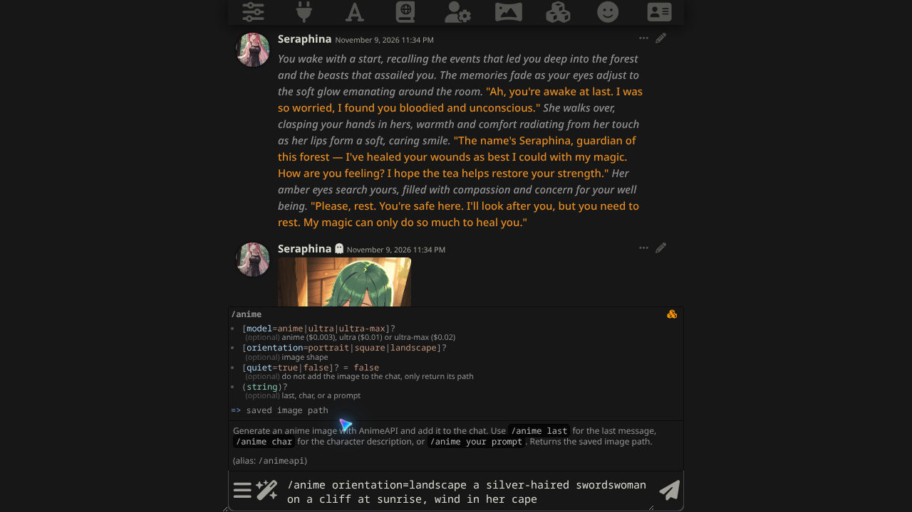

# AnimeAPI Image Generation for SillyTavern

Generate anime illustrations from your SillyTavern chat with [AnimeAPI](https://animeapi.ai), one of the cheapest anime image APIs: **$0.003 per image**, prepaid balance from $5 that never expires, no subscription. New accounts get 3 free images, no card needed.

**English** · [简体中文](README.zh-CN.md) · [日本語](README.ja.md)



## Features

- Illustrate the **last message**, the **character**, or any **prompt you type**
- A `/anime` slash command, three entries in the wand menu, and a button on every message
- Pick the model (`anime` $0.003, `ultra` $0.01, `ultra-max` $0.02) and the shape (portrait, square, landscape)
- Shows the **price per image** and your **remaining balance**
- Images are downloaded and saved into your SillyTavern images folder, then added to the chat
- Clear errors: an empty balance links to the add-funds page, a rejected image tells you why
- No server plugin, no extra software, nothing to run locally. Interface in English, 简体中文 and 日本語

## Install

1. In SillyTavern open **Extensions** (the cubes icon) → **Install extension**.
2. Paste this URL and confirm:

   ```
   https://github.com/animeapi-ai/SillyTavern-AnimeAPI
   ```

3. Open **Extensions → AnimeAPI Image Generation** and paste your API key. Get one at <https://animeapi.ai/dashboard/api-keys> (keys start with `ank_`).

Requires SillyTavern 1.12.6 or newer. Tested on 1.19.0.



## Use

| Where | What it does |
| --- | --- |
| Wand menu → **AnimeAPI: last message** | Draws the scene from the last chat message |
| Wand menu → **AnimeAPI: character** | Draws the current character from its description |
| Wand menu → **AnimeAPI: custom prompt** | Asks you what to draw |
| Message **⋯** menu → sparkle button | Draws that message |
| `/anime last`, `/anime char`, `/anime a girl with a red umbrella` | The same, as a slash command |

The slash command takes optional arguments and returns the saved image path, so it works in Quick Replies and scripts:

```
/anime model=ultra orientation=landscape a cafe chalkboard that reads OPEN LATE
/anime quiet=true char | /echo saved to {{pipe}}
```



## Settings

| Setting | Default | Notes |
| --- | --- | --- |
| API key | empty | Stored in your own SillyTavern settings, sent only to `animeapi.ai` |
| Model | `anime` | `anime` $0.003, `ultra` $0.01, `ultra-max` $0.02 per image |
| Orientation | Portrait | Portrait, square or landscape; same price |
| Always add | empty | Text added to every prompt, for example your character's look |
| Rewrite my prompt into tags | on | AnimeAPI turns plain sentences into tags for the anime model |
| Hide generated images from the AI's context | on | The image message is not sent to your chat model |

Chat text is cleaned of markdown and cut to AnimeAPI's 1,000-character prompt limit.

AnimeAPI does not generate adult content. Explicit prompts are refused and not charged.

## Errors you may see

| Message | Meaning |
| --- | --- |
| Your AnimeAPI balance is empty | Add funds at <https://animeapi.ai/dashboard/billing> (from $5) |
| AnimeAPI did not accept this key | Check the key at <https://animeapi.ai/dashboard/api-keys> |
| The image was rejected: … | AnimeAPI refused this prompt; the reason it gives is shown and you are not charged |
| AnimeAPI is busy | Temporary; try again in a few seconds. Failed images are refunded |

## Can I use SillyTavern's built-in Image Generation instead?

Not today. SillyTavern's built-in Image Generation extension (checked on 1.19.0) has no source that accepts a custom OpenAI-compatible base URL: its "OpenAI" source always calls OpenAI's own servers. AnimeAPI's OpenAI-compatible endpoint (`https://animeapi.ai/v1`) works with tools that let you set a base URL; for SillyTavern, use this extension.

## Privacy

The extension talks to two places only: your own SillyTavern server (to save the image) and `https://animeapi.ai` (to generate it). There is no analytics.

## Links

- AnimeAPI: <https://animeapi.ai> · [Docs](https://animeapi.ai/docs) · [API reference](https://animeapi.ai/docs/api-reference)
- Licence: [MIT](LICENSE)
