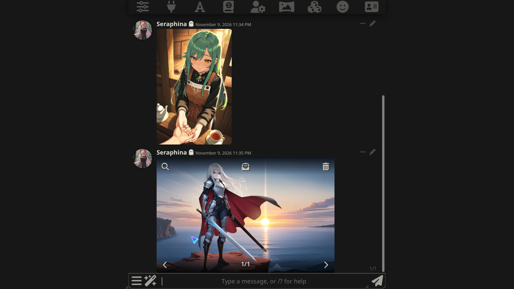
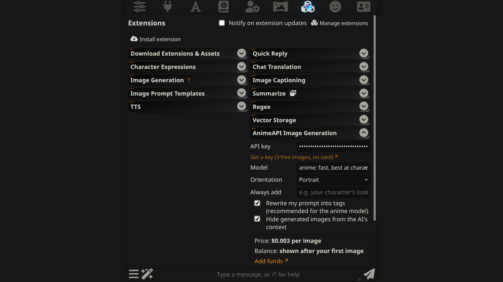

# AnimeAPI 图片生成（SillyTavern 扩展）

用 [AnimeAPI](https://animeapi.ai) 为 SillyTavern（酒馆）聊天生成动漫插画。AnimeAPI 是最便宜的动漫图片 API 之一：**每张 $0.003**，预付余额 $5 起、永不过期，无订阅。新账号免费 3 张，无需绑卡。

[English](README.md) · **简体中文** · [日本語](README.ja.md)



## 功能

- 为**最后一条消息**、**当前角色**或**任意提示词**配图
- `/anime` 斜杠命令、魔杖菜单三个入口、每条消息上的按钮
- 可选模型（`anime` $0.003、`ultra` $0.01、`ultra-max` $0.02）与画幅（竖图、方图、横图）
- 显示**每张价格**与**剩余余额**
- 图片会下载并保存到 SillyTavern 的图片目录，再插入聊天
- 清晰的报错：余额不足时给出充值链接，图片被拒绝时显示原因
- 无需服务器插件，无需本地显卡。界面支持 English、简体中文、日本語

## 安装

1. 在 SillyTavern 打开 **扩展**（方块图标）→ **安装扩展**。
2. 粘贴以下地址并确认：

   ```
   https://github.com/animeapi-ai/SillyTavern-AnimeAPI
   ```

3. 打开 **扩展 → AnimeAPI 图片生成**，填入 API 密钥。密钥在 <https://animeapi.ai/dashboard/api-keys> 创建（以 `ank_` 开头）。

需要 SillyTavern 1.12.6 或更高版本，已在 1.19.0 上测试。



## 使用

| 入口 | 作用 |
| --- | --- |
| 魔杖菜单 → **AnimeAPI：最后一条消息** | 根据最后一条消息绘制场景 |
| 魔杖菜单 → **AnimeAPI：角色** | 根据角色描述绘制当前角色 |
| 魔杖菜单 → **AnimeAPI：自定义提示词** | 输入想画的内容 |
| 消息 **⋯** 菜单 → 闪光按钮 | 为该条消息配图 |
| `/anime last`、`/anime char`、`/anime 打着红伞的女孩` | 同上，斜杠命令形式 |

斜杠命令支持可选参数，并返回保存后的图片路径，可用于快速回复和脚本：

```
/anime model=ultra orientation=landscape a cafe chalkboard that reads OPEN LATE
/anime quiet=true char | /echo saved to {{pipe}}
```

## 设置

| 设置 | 默认 | 说明 |
| --- | --- | --- |
| API 密钥 | 空 | 保存在你自己的 SillyTavern 设置中，只发送给 `animeapi.ai` |
| 模型 | `anime` | 每张 `anime` $0.003、`ultra` $0.01、`ultra-max` $0.02 |
| 画幅 | 竖图 | 竖图、方图、横图，价格相同 |
| 固定附加 | 空 | 附加到每条提示词的文字，例如角色外貌 |
| 自动改写为标签 | 开 | AnimeAPI 会把自然语言改写成 anime 模型使用的标签 |
| 生成的图片不计入 AI 上下文 | 开 | 图片消息不会发送给聊天模型 |

聊天文本会去除 Markdown 并截断到 AnimeAPI 的 1000 字符上限。

AnimeAPI 不生成成人内容。露骨的提示词会被拒绝，且不收费。

## 常见提示

| 提示 | 含义 |
| --- | --- |
| 你的 AnimeAPI 余额不足 | 在 <https://animeapi.ai/dashboard/billing> 充值（$5 起） |
| AnimeAPI 未接受该密钥 | 在 <https://animeapi.ai/dashboard/api-keys> 检查密钥 |
| 图片被拒绝：… | AnimeAPI 拒绝了该提示词；会显示其给出的原因，且不扣费 |
| AnimeAPI 繁忙 | 临时情况，稍后重试。失败的图片会退款 |

## 能否直接用 SillyTavern 自带的图片生成？

目前不行。SillyTavern 自带的 Image Generation 扩展（1.19.0）没有可填写自定义 OpenAI 兼容地址的来源，其 “OpenAI” 来源固定请求 OpenAI 官方服务器。请使用本扩展。

## 链接

- AnimeAPI：<https://animeapi.ai> · [文档](https://animeapi.ai/docs) · [API 参考](https://animeapi.ai/docs/api-reference)
- 许可证：[MIT](LICENSE)
